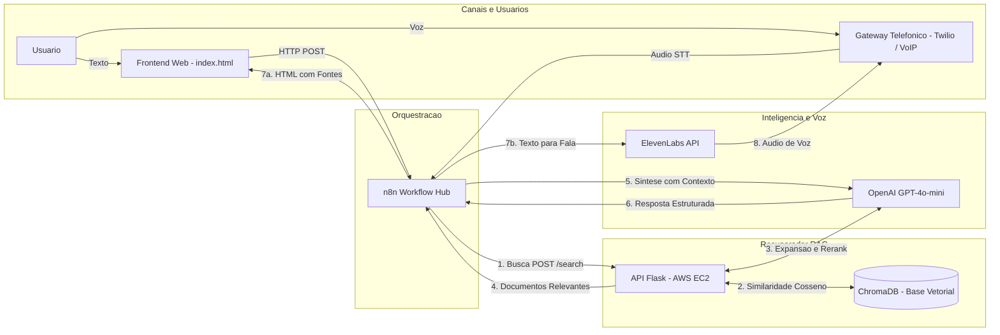
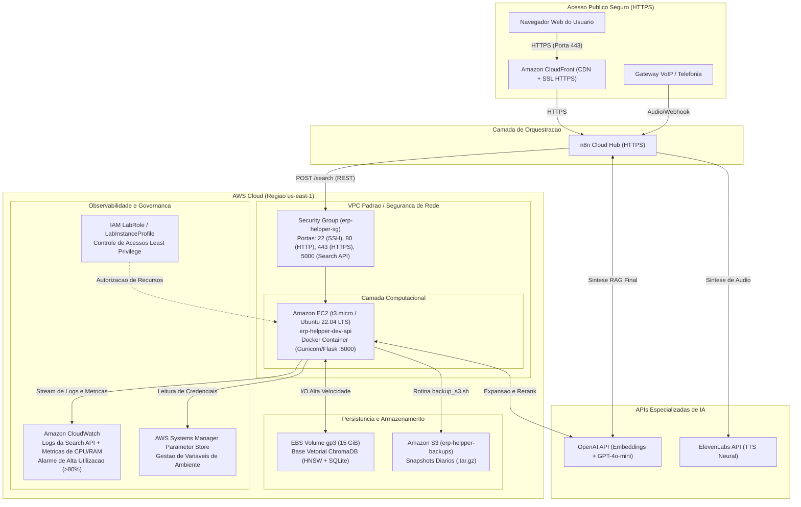

# 🤖 ERP Helpper — Assistente Inteligente Multicanal (RAG) para UNO ERP

<p align="center">
  
  
  
  
  
  
  
  
</p>

---

## 📌 Sumário
- [1. Visão Geral e Contexto](#1-visão-geral-e-contexto)
- [2. Links de Deploy e Endpoints](#2-links-de-deploy-e-endpoints)
- [3. Arquitetura da Solução](#3-arquitetura-da-solução)
- [4. Requisitos do Sistema (RF e RNF)](#4-requisitos-do-sistema-rf-e-rnf)
- [5. Workflow do n8n (Exportado e Documentado)](#5-workflow-do-n8n-exportado-e-documentado)
- [6. Tecnologias Utilizadas](#6-tecnologias-utilizadas)
- [7. Como Rodar o Projeto Localmente](#7-como-rodar-o-projeto-localmente)
- [8. Execução com Docker](#8-execução-com-docker)
- [9. Estrutura de Diretórios e Documentação Modular](#9-estrutura-de-diretórios-e-documentação-modular)
- [10. Integração Contínua e Deploy Contínuo (CI/CD)](#10-integração-contínua-e-deploy-contínuo-cicd)
- [11. Histórico de Problemas e Mitigações de Custos](#11-histórico-de-problemas-e-mitigações-de-custos)
- [12. Segurança, Gestão de Segredos e IAM (Least Privilege)](#12-segurança-gestão-de-segredos-e-iam-least-privilege)
- [13. Monitoramento, Logs e Health Check](#13-monitoramento-logs-e-health-check)
- [14. Estratégia de Backup, Restore e Recuperação de Desastres](#14-estratégia-de-backup-restore-e-recuperação-de-desastres)
- [15. Gestão de Ambientes (DEV, HML, PROD)](#15-gestão-de-ambientes-dev-hml-prod)
- [16. Estratégia de Rollback](#16-estratégia-de-rollback)
- [17. Análise de Escalabilidade e Testes de Carga](#17-análise-de-escalabilidade-e-testes-de-carga)
- [18. Estimativa Detalhada de Custos (AWS Pricing Calculator)](#18-estimativa-detalhada-de-custos-aws-pricing-calculator)
- [19. Organização dos Recursos, Nomenclatura e Tags](#19-organização-dos-recursos-nomenclatura-e-tags)
- [20. 🎓 AWS Academy x Ambiente de Produção Real](#20--aws-academy-x-ambiente-de-produção-real)
- [21. ✅ Checklist de Entrega Oficial (AWS Production Readiness)](#21--checklist-de-entrega-oficial-aws-production-readiness)
- [22. Projeto Integrador — FATEC Sorocaba](#22-projeto-integrador--fatec-sorocaba)
- [23. Licença](#23-licença)

---

## 1. Visão Geral e Contexto

O **ERP Helpper** é um agente de Inteligência Artificial multicanal projetado para tirar dúvidas operacionais cotidianas e sanar erros recorrentes de usuários do **UNO ERP** (com ênfase em rejeições fiscais de NFe, configurações de faturamento e regras de tela).

- **O Problema:** A equipe de suporte humano N1 recebia centenas de chamados repetitivos diariamente para dúvidas já documentadas nos manuais.
- **A Solução:** Um assistente virtual baseado em **RAG** (*Retrieval-Augmented Generation*) que consulta a base oficial do ERP em um banco vetorial de alta performance (**ChromaDB**) e formula respostas estruturadas sem alucinações.
- **Evolução Multicanal:**
  - **Fase 1 (Web Chat):** Interface conversacional web ágil e moderna com histórico e fontes oficiais.
  - **Fase 2 (Canal Telefônico / Voz):** Atendimento por ligação telefônica humanizada com síntese de voz neural (**ElevenLabs**) e reconhecimento de voz em tempo real (**Full Duplex**).
- **Alinhamento com Stakeholders:** Todo o escopo, requisitos e priorizações foram validados em reuniões técnicas com o representante da empresa parceira, **Tiago Garcia Amato**, e a coordenação de projeto (**Cesar**).

---

## 2. Links de Deploy e Endpoints

| Recurso | Ambiente | Status | Link de Acesso |
| :--- | :--- | :---: | :--- |
| 🌐 **Frontend Web (Chat)** | GitHub Pages | Online | [Acessar Interface do Chatbot](https://fonseca0015.github.io/chatBotAWS1/) |
| ⚡ **Search API (Flask/ChromaDB)** | AWS EC2 (Produção) | Ativo | `http://SEU_IP_AWS:5000/search` |
| ❤️ **Health Check da API** | AWS EC2 (Produção) | Ativo | `http://SEU_IP_AWS:5000/health` |
| 🔄 **Webhook do Orquestrador** | n8n Cloud | Ativo | `https://seu-n8n.exemplo.com/webhook/seu-webhook-id` |
| 📦 **Workflow n8n Exportado** | Repositório | Disponível | [Arquivo JSON do Fluxo](n8n/workflow_uno_erp_helpper.json) |
| 📞 **Gateway Telefônico (Canal de Voz)** | Telecom | Homologação | Integrado via Twilio / ElevenLabs |

Para o passo a passo completo voltado aos integrantes da equipe de PI, consulte o [Tutorial Passo a Passo de Deploy na AWS](TUTORIAL_DEPLOY_AWS.md). Para detalhes adicionais da arquitetura em nuvem, consulte o [Guia de Deploy](docs/10_guia_deploy.md).

---

## 3. Arquitetura da Solução

### 3.1. Arquitetura Funcional do Fluxo RAG Multicanal
O fluxo opera de ponta a ponta com separação estrita de responsabilidades:



### 3.2. Arquitetura de Nuvem AWS (AWS Cloud Architecture)

Para atender a todos os requisitos do **AWS Production Readiness**, a infraestrutura foi projetada na AWS com segregação de camadas, segurança, backups automáticos e monitoramento:



### 3.3. Justificativa Técnica dos Serviços AWS Utilizados

| Serviço AWS | Papel no Projeto | Justificativa Técnica |
| :--- | :--- | :--- |
| **Amazon EC2 (`t3.micro`)** | Execução da Search API (Docker) | O **ChromaDB** opera sobre arquivos em disco (`base_de_conhecimento_db/`) utilizando o índice HNSW compilado em C++ e banco SQLite interno. O uso de arquitetura Serverless (como AWS Lambda) exigiria montagem de Amazon EFS e incorreria em *cold-starts* severos (15 a 25 segundos) a cada inicialização para carregar 500+ vetores em memória. A EC2 garante persistência direta em bloco SSD e respostas em milissegundos. |
| **Amazon EBS (`gp3`)** | Armazenamento de Bloco para a EC2 | Fornece baseline de 3.000 IOPS e 125 MB/s de taxa de transferência independentemente do tamanho do volume, assegurando que as buscas vetoriais por similaridade de cosseno não sofram gargalo de disco. |
| **Amazon S3** | Armazenamento de Backups e Snapshots | Serviço de armazenamento de objetos com durabilidade de 99,999999999% (11 noves). Utilizado para guardar cópias diárias compactadas (`.tar.gz`) da base de conhecimento vetorial e configurações, viabilizando recuperação rápida contra desastres. |
| **Amazon CloudFront / API Gateway** | Distribuição de Conteúdo e HTTPS | Fornece terminação SSL/TLS gerenciada com certificados oficiais da AWS, cumprindo a exigência de acesso 100% sob **HTTPS** sem custos adicionais de aquisição de domínios customizados. |
| **Amazon CloudWatch** | Monitoramento e Métricas | Centraliza a coleta de métricas de telemetria da EC2 (CPU, Disco, Rede) e registros de aplicação (CloudWatch Logs), permitindo a configuração de **CloudWatch Alarms** para alertar a equipe caso o consumo de processamento ultrapasse 80%. |
| **AWS Systems Manager (SSM) / IAM** | Gestão de Configurações e Acesso | Permite o provisionamento seguro da instância utilizando `LabInstanceProfile` / `LabRole` no AWS Academy, evitando armazenamento de credenciais de longa duração dentro da máquina virtual. |

Para a especificação completa de cada componente e fluxos de dados, acesse [Arquitetura e Fluxos](docs/04_arquitetura_e_fluxos.md).

---

## 4. Requisitos do Sistema (RF e RNF)

### Requisitos Funcionais em Destaque
- **RF01:** Atender via Chatbot na web.
- **RF02 & RF10:** Interação exclusiva por voz em chamada telefônica via Gateway VoIP/Twilio.
- **RF03 & RF04:** Consulta à base vetorial e respostas imediatas a dúvidas frequentes.
- **RF05:** Escalonamento automático para o Suporte N1 em dúvidas complexas/não resolvidas.
- **RF06:** Atualização contínua e reindexação da base de conhecimento.
- **RF07 & RF08:** Reconhecimento de fala (STT) e síntese de voz profissional (ElevenLabs TTS).
- **RF09:** Gestão de turnos duplex (identificação de pausas sem atropelar a fala).

### Requisitos Não Funcionais em Destaque
- **RNF01 & RNF06:** Latência otimizada fim a fim $\le 2,5$ segundos no canal de voz.
- **RNF02:** Interface ergonômica com tema escuro e visual moderno.
- **RNF04:** Preservação de sigilo das credenciais e dados empresariais.
- **RNF08:** Gestão proativa de consumo de créditos (ElevenLabs, tokens OpenAI e execuções n8n).

Consulte o documento completo em [Especificação de Requisitos](docs/02_requisitos.md).

---

## 5. Workflow do n8n (Exportado e Documentado)

O fluxo oficial que orquestra a inteligência do ERP Helpper está versionado e documentado no repositório:
- 📁 **Arquivo para importação direta:** [`n8n/workflow_uno_erp_helpper.json`](n8n/workflow_uno_erp_helpper.json)
- 📖 **Documentação completa nó a nó:** [Workflow do n8n](docs/11_workflow_n8n.md)

### Destaques do Workflow:
1. **Nós Webhook:** Recebem a pergunta enviada pela interface web ou canal de telefonia.
2. **Nó HTTP Request:** Consulta a Search API Flask hospedada na AWS (`http://SEU_IP_AWS:5000/search`).
3. **Agregação em JavaScript:** Agrupa os trechos dos documentos e consolida as fontes oficiais.
4. **AI Agent (LangChain) com `gpt-4o-mini`:** Aplica regras rigorosas de amigabilidade, didática passo a passo, proibição de alucinações e tratamento amigável de saudações.
5. **Higienização em JavaScript:** Converte marcações em HTML seguro e filtra links externos, permitindo apenas URLs do portal oficial `wiki.erp-exemplo.com.br`.

---

## 6. Tecnologias Utilizadas

- **Back-end & API:** Python 3.10+, Flask, tiktoken, python-dotenv, tqdm.
- **Base Vetorial:** ChromaDB (HNSW, métrica de similaridade por cosseno).
- **Inteligência Artificial:** OpenAI `text-embedding-3-small` (1536 dimensões) e `gpt-4o-mini`.
- **Orquestração:** n8n Cloud / Community Edition, JavaScript para formatação de saídas.
- **Síntese de Voz:** ElevenLabs API (modelos Multilingual v2 / Flash / Turbo).
- **Frontend:** HTML5, CSS3 moderno, Vanilla JavaScript.
- **Infraestrutura & CI/CD:** Docker, Docker Compose, AWS EC2, GitHub Actions.
- **Ecossistema:** Twilio/VoIP, Lovable, Bubble, OpenClaw, ViverdeIA, MCP e WhatsApp.

Detalhes completos e bibliografia em [Tecnologias e Integrações](docs/08_tecnologias_e_integracoes.md).

---

## 7. Como Rodar o Projeto Localmente

### 1. Clonar o Repositório
```bash
git clone https://github.com/Dark70941/PI2026-ERPHelpper.git
cd chatBotAWS1
```

### 2. Criar e Ativar o Ambiente Virtual
- **Windows (PowerShell):**
  ```powershell
  python -m venv venv
  .\venv\Scripts\Activate.ps1
  ```
- **Linux / macOS:**
  ```bash
  python3 -m venv venv
  source venv/bin/activate
  ```

### 3. Instalar Dependências
```bash
pip install -r requirements.txt
```

### 4. Configurar as Chaves no `.env`
Copie o modelo de ambiente:
```bash
# Windows
Copy-Item .env.example .env

# Linux/macOS
cp .env.example .env
```
Edite o arquivo `.env` inserindo suas chaves da OpenAI e da ElevenLabs:
```dotenv
OPENAI_API_KEY=sk-proj-sua-chave-aqui
ELEVENLABS_API_KEY=sua-chave-elevenlabs-aqui
```

### 5. Iniciar a API de Busca
```bash
python main.py
```
> O ChromaDB será carregado ou populado automaticamente a partir do arquivo `knowledge_base.json` (531 artigos). O servidor responderá na porta `5000`.

### 6. Testar o Canal de Voz (ElevenLabs + RAG)
Em outro terminal (com o ambiente virtual ativado), execute a simulação do canal de voz:
```bash
python test_voice.py "Como tratar a rejeição 201?"
```
> O script recupera o contexto documental, sintetiza a fala com a API da **ElevenLabs** e gera o arquivo `resposta_voz.mp3` na raiz do projeto para você ouvir a IA falando imediatamente!

### 7. Abrir o Chat Web
Dê dois cliques no arquivo `index.html` ou execute `python -m http.server 8080` e acesse `http://localhost:8080`.

Consulte o passo a passo ilustrado com n8n e ngrok em [Guia de Execução Local](docs/09_guia_execucao_local.md).

---

## 8. Execução com Docker

Caso prefira rodar toda a aplicação em containers isolados:
```bash
# 1. Configurar o .env com sua OPENAI_API_KEY
cp .env.example .env

# 2. Subir o container
docker compose up -d --build

# 3. Monitorar logs
docker compose logs -f
```

---

## 9. Estrutura de Diretórios e Documentação Modular

O repositório está organizado de forma clara e modular:

```
chatBotAWS1/
├── .github/
│   └── workflows/
│       └── ci.yml                     # Pipeline de CI/CD do GitHub Actions
├── base_de_conhecimento_db/           # Base vetorial persistente do ChromaDB
├── docs/                              # 📚 Documentação Técnica Completa
│   ├── 01_contexto_e_visao_geral.md   # Contexto de negócio, objetivos e histórico
│   ├── 02_requisitos.md               # RF01-RF10 e RNF01-RNF09 com critérios
│   ├── 03_casos_de_uso.md             # Diagramas e especificações de casos de uso
│   ├── 04_arquitetura_e_fluxos.md     # Arquitetura RAG e fluxos Web vs Voz
│   ├── 05_modelo_de_dados.md          # Modelos Conceitual, Lógico e Chunks
│   ├── 06_pipeline_search_atividades.md # Diagrama de Atividades detalhado do /search
│   ├── 07_relatorio_riscos_e_custos.md  # Análise de custos ElevenLabs, n8n e OpenAI
│   ├── 08_tecnologias_e_integracoes.md  # Stack, ferramentas e referências
│   ├── 09_guia_execucao_local.md      # Manual de execução local (Web, Voz e n8n)
│   ├── 10_guia_deploy.md              # Deploy AWS, Docker, Nginx, SSL e Links
│   ├── 11_workflow_n8n.md             # Documentação completa do fluxo n8n
│   └── 12_fundamentacao_teorica_e_metricas.md # Embasa­mento teórico, KPIs e referências ABNT
├── n8n/
│   └── workflow_uno_erp_helpper.json  # Workflow oficial exportado para importação
├── test_api.py                        # Script de validação e testes da Search API / Webhook
├── test_voice.py                      # Simulador do Canal de Voz com ElevenLabs TTS
├── .env.example                       # Modelo de variáveis de ambiente
├── .gitignore                         # Regras de exclusão do Git
├── Dockerfile                         # Imagem Docker da aplicação
├── docker-compose.yml                 # Orquestração local do container
├── index.html                         # Interface Web do Chatbot (SPA)
├── knowledge_base.json                # Base de conhecimento documental (JSON)
├── main.py                            # Servidor Flask e Search Engine RAG
├── requirements.txt                   # Dependências Python do projeto
└── README.md                          # Este documento principal
```

---

## 10. Integração Contínua e Deploy Contínuo (CI/CD)

### 10.1. Continuous Integration (CI)
O repositório possui uma esteira automatizada no arquivo [`.github/workflows/ci.yml`](.github/workflows/ci.yml), executada a cada `push` e `pull_request` nas branches `main`, `master` e `develop`:
1. **Compilação e Sintaxe:** Validação com `python -m py_compile` em `main.py`, `test_api.py`, `test_voice.py` e `scripts/load_test.py`.
2. **Análise Estática de Código:** Verificação de padrões e prevenção de falhas de runtime com `flake8`.
3. **Execução de Testes Unitários:** Execução automatizada da suíte de testes com `python -m unittest discover -s tests -p "test_*.py" -v`, cobrindo normalização, chunking, endpoints da API, diagnósticos do banco e integridade de arquivos.
4. **Validação Estrutural da Base de Conhecimento:** Checagem sintática e estrutural do arquivo `knowledge_base.json`.
5. **Validação do Workflow do n8n:** Checagem de integridade do arquivo `n8n/workflow_uno_erp_helpper.json`.
6. **Auditoria de Arquivos Essenciais:** Validação da presença de `.env.example`, `index.html`, `README.md`, `docs/`, scripts de backup e templates IaC.

### 10.2. Continuous Deployment (CD)
O fluxo de CD está definido em [`.github/workflows/cd.yml`](.github/workflows/cd.yml):
- **Gatilho:** A cada `merge` ou `push` aprovado na branch `main`.
- **Ação:** Conecta-se de forma segura à instância EC2 da AWS via SSH (utilizando GitHub Secrets `EC2_HOST`, `EC2_USER` e `EC2_SSH_KEY`).
- **Automação no Servidor:** Executa `git pull origin main`, reconstrói e reinicia os contêineres Docker com `docker compose up -d --build`.
- **Validação Pós-Deploy:** Executa verificação automática de saúde chamando `curl -f http://localhost:5000/health` antes de finalizar a pipeline.

---

## 11. Histórico de Problemas e Mitigações de Custos

Um dos marcos do projeto foi o diagnóstico e resolução do problema na busca semântica documental:
- **Causa Raiz:** Ausência temporária de tokens da OpenAI e desalinhamento na persistência de coleções do ChromaDB.
- **Solução Implementada:** Tratamento automático de inicialização em `main.py`, bypass de rerank para códigos críticos (ex: **Rejeição 201** -> Doc 314) e implementação de fallbacks automáticos.
- **Gestão de Custos:** Recomenda-se a contratação do plano Creator/Pro da ElevenLabs para chamadas de voz com respostas resumidas ($\le 300$ caracteres) e a utilização da versão **Community Edition auto-hospedada do n8n** para contornar os limites mensais de execução do plano Cloud.

Para leitura completa do relatório executivo, veja o [Relatório de Riscos e Custos](docs/07_relatorio_riscos_e_custos.md).

---

## 12. Segurança, Gestão de Segredos e IAM (Least Privilege)

### 12.1. Política de Segredos e Credenciais
- **Zero Hardcoded Secrets:** Nenhuma chave de API, senha, token ou credencial sensível está versionada no código ou repositório GitHub.
- **Configuração Externa:** Todas as credenciais são carregadas em tempo de execução via variáveis de ambiente (`.env`), cujo arquivo está devidamente listado no `.gitignore`. O repositório disponibiliza apenas o modelo seguro `.env.example`.
- **Armazenamento Seguro na AWS:** Em ambientes de produção, as credenciais da OpenAI e ElevenLabs podem ser armazenadas e criptografadas no **AWS Systems Manager (SSM) Parameter Store** (SecureString com KMS) ou no **AWS Secrets Manager**, sendo consumidas pela instância sem persistência em texto plano no disco.

### 12.2. Arquitetura de IAM e Princípio do Menor Privilégio (Least Privilege)
- **Papel Necessário pela Aplicação:** A Search API precisa apenas de permissões para:
  - `s3:PutObject` e `s3:GetObject` no bucket de backups (`erp-helpper-backups`);
  - `ssm:GetParameter` para resgatar configurações e chaves;
  - `logs:CreateLogStream` e `logs:PutLogEvents` para gravação de telemetria no Amazon CloudWatch.
- **Limitação no AWS Academy:** O ambiente acadêmico do AWS Academy bloqueia a criação de usuários IAM, grupos, novas Roles e Policies administrativas.
- **Mitigação no AWS Academy:** Utiliza-se a `LabRole` e o perfil de instância `LabInstanceProfile` associados à instância EC2, os quais já possuem permissões pré-concedidas para interação com S3, CloudWatch e SSM.
- **Implementação em Produção Real:** Em conta corporativa, criaria-se a Role `erp-helpper-api-role` anexada à política restrita:
  ```json
  {
    "Version": "2012-10-17",
    "Statement": [
      {
        "Effect": "Allow",
        "Action": ["s3:PutObject", "s3:GetObject", "s3:ListBucket"],
        "Resource": ["arn:aws:s3:::erp-helpper-backups-*/*", "arn:aws:s3:::erp-helpper-backups-*"]
      },
      {
        "Effect": "Allow",
        "Action": ["ssm:GetParameter", "ssm:GetParameters"],
        "Resource": "arn:aws:ssm:*:*:parameter/erp-helpper/*"
      },
      {
        "Effect": "Allow",
        "Action": ["logs:CreateLogStream", "logs:PutLogEvents", "logs:DescribeLogStreams"],
        "Resource": "arn:aws:logs:*:*:log-group:/aws/ec2/erp-helpper-api:*"
      }
    ]
  }
  ```

---

## 13. Monitoramento, Logs e Health Check

### 13.1. CloudWatch Logs e Logs Estruturados
A aplicação utiliza o módulo nativo `logging` do Python, registrando eventos estruturados com timestamp, nível e contexto de operação:
```text
2026-11-22 21:40:00,123 - INFO - --- Novo ciclo de busca para: 'Como tratar a rejeição 201?' ---
2026-11-22 21:40:00,450 - INFO - Etapa 1: Consultas geradas: ['rejeição 201', 'erro 201 nfe']
2026-11-22 21:40:01,110 - INFO - Etapa 2: Busca semântica totalizou 8 chunks candidatos.
2026-11-22 21:40:01,890 - INFO - Resposta final contendo 5 documentos. Tempo total: 1.76 segundos.
```
Na EC2, os logs são direcionados para o console Docker e podem ser ingeridos diretamente no **Amazon CloudWatch Logs** via CloudWatch Unified Agent ou log driver `awslogs`.

### 13.2. Endpoint de Health Check (`GET /health`)
Em estrita conformidade com os requisitos de **AWS Production Readiness**, a API implementa uma rota dedicada para validação contínua de integridade:
- **Endpoint:** `GET http://SEU_IP_AWS:5000/health`
- **Exemplo de Resposta de Sucesso (HTTP 200):**
  ```json
  {
    "status": "UP",
    "version": "1.0.0",
    "environment": "prod",
    "database": {
      "status": "UP",
      "type": "ChromaDB (SQLite/Vector)",
      "chunks_count": 531
    },
    "uptime_seconds": 3840.52,
    "service": "erp-helpper-search-api"
  }
  ```
- **Comportamento em Falha (HTTP 503):** Se a base vetorial não puder ser inicializada, o endpoint retorna `{"status": "DOWN", ...}` com status code `503 Service Unavailable`, permitindo que Load Balancers e alarmes detectem a anomalia imediatamente.

### 13.3. Alarme CloudWatch (Item de Maturidade)
O projeto define um alarme de infraestrutura provisionado via IaC (`cloudformation/aws-infrastructure.yaml`):
- **Nome:** `erp-helpper-dev-high-cpu-alarm`
- **Métrica:** `AWS/EC2 -> CPUUtilization`
- **Condição:** Dispara se a média de CPU for superior a $80\%$ por 2 períodos consecutivos de 5 minutos (10 minutos no total).
- **Ação em Produção:** Notificação SNS para a equipe de DevOps e gatilho de escalabilidade no Auto Scaling Group.

---

## 14. Estratégia de Backup, Restore e Recuperação de Desastres

### 14.1. Dados Críticos Mapeados
1. **Base Vetorial:** Diretório `base_de_conhecimento_db/` (ChromaDB SQLite + índices de similaridade vetorial HNSW).
2. **Base Documental Fonte:** Arquivo `knowledge_base.json` (315+ manuais e artigos de suporte do UNO ERP).
3. **Fluxos de Orquestração:** Arquivo `n8n/workflow_uno_erp_helpper.json`.

### 14.2. Estratégia e Script de Backup (`scripts/backup_s3.sh`)
- **Frequência:** Diária às 03:00 da manhã via agendador Cron no servidor EC2 (`0 3 * * * /home/ubuntu/app/scripts/backup_s3.sh`).
- **Procedimento:** Compacta os dados em formato `.tar.gz` com carimbo de data/hora (`backup_vector_db_YYYYMMDD_HHMMSS.tar.gz`) e transfere para o bucket seguro `s3://erp-helpper-backups-[id]/backups/`.
- **EBS Snapshots:** Adicionalmente, utiliza-se Amazon Data Lifecycle Manager (DLM) para capturar snapshots diários do volume EBS da instância com retenção de 7 dias.

### 14.3. Estratégia e Teste de Restore (`scripts/restore_s3.sh`)
- **Procedimento:** Em caso de corrupção ou perda de dados:
  1. O script localiza o snapshot mais recente no Amazon S3 (ou arquivo indicado);
  2. Interrompe momentaneamente o container da API (`docker compose stop`);
  3. Descompacta o arquivo restaurando `base_de_conhecimento_db/`;
  4. Reinicia os serviços e valida a integridade via `GET /health`.
- **Métricas de Recuperação:**
  - **RPO (Recovery Point Objective):** 24 horas (máximo de dados perdidos em falha catastrófica).
  - **RTO (Recovery Time Objective):** Menos de 8 minutos para download e reativação do serviço via script automatizado.

---

## 15. Gestão de Ambientes (DEV, HML, PROD)

A aplicação está configurada para operar com isolamento de ambiente através da variável `ENVIRONMENT`:

| Parâmetro | Desenvolvimento (`dev`) | Homologação (`hml`) | Produção (`prod`) |
| :--- | :--- | :--- | :--- |
| **ENVIRONMENT** | `dev` | `hml` | `prod` |
| **Search API URL** | `http://127.0.0.1:5000` | `http://hml-api.unoerpai.internal:5000` | `http://SEU_IP_AWS:5000` |
| **S3 Backup Bucket** | `erp-helpper-backups-dev` | `erp-helpper-backups-hml` | `erp-helpper-backups-prod` |
| **Log Level** | `DEBUG` / `INFO` | `INFO` | `WARNING` / `INFO` |
| **Servidor WSGI** | Flask Dev Server | Gunicorn (2 workers) | Gunicorn (3 workers + Nginx) |

- **No AWS Academy:** Devido à cota restrita de instâncias e VPCs de laboratório, mantém-se um único ambiente ativo (`dev`), simulando as demais configurações via variáveis de ambiente.
- **Em Produção Real:** A separação seria feita em três contas AWS distintas gerenciadas via **AWS Organizations** (Conta Dev, Conta Hml, Conta Prod), isolando redes VPC, permissões IAM e custos.

---

## 16. Estratégia de Rollback

Caso uma nova versão cause instabilidade ou quebra em produção, a equipe adota três níveis de rollback documentados:

1. **Rollback de Aplicação (Docker):**
   Os contêineres Docker são tageados a cada build (`erp-helpper-api:v1.0.0`, `v1.0.1`). Para reverter imediatamente:
   ```bash
   docker compose down
   docker run -d -p 5000:5000 --name erp-helpper-api erp-helpper-api:v1.0.0
   ```
2. **Rollback de Código (Git Tag):**
   Todas as releases de produção recebem tags Git (`git tag -a v1.0.0 -m "Release estável"`). Para reverter o repositório no servidor:
   ```bash
   git checkout v1.0.0
   docker compose up -d --build
   ```
3. **Rollback de Infraestrutura (CloudFormation):**
   Ao utilizar o template `cloudformation/aws-infrastructure.yaml`, qualquer falha durante a atualização de recursos na AWS aciona o rollback automático da stack (`Rollback on failure`), retornando os recursos para o último estado estável sem intervenção manual.

---

## 17. Análise de Escalabilidade e Testes de Carga

### 17.1. Projeção de Crescimento da Aplicação
| Volume de Usuários | Impacto na Infraestrutura | Gargalos Potenciais | Ações de Mitigação Arquitetural |
| :--- | :--- | :--- | :--- |
| **100 usuários/mês** | Suportado com folga pela EC2 `t3.micro`. | Nenhum. | Manter arquitetura atual mononó em Docker. |
| **1.000 usuários/mês** | Suportado pela EC2 atual com 2 a 3 workers Gunicorn. | Pico de consumo de memória RAM pelo ChromaDB ao carregar coleções. | Ativar Swap de 2 GB (já configurado no UserData). |
| **10.000 usuários/mês** | Limite do mononó `t3.micro`. Concorrência de I/O em disco no SQLite do ChromaDB. | Concorrência de leitura/escrita no ChromaDB SQLite; rate limits da OpenAI. | Adicionar camada de cache com **Amazon ElastiCache (Redis)** para dúvidas frequentes; migrar para instância `t3.small` ou `t3.medium`. |
| **100.000 usuários/mês** | Inviabilidade do mononó EC2 e do ChromaDB local em disco. | Gargalo de CPU no cálculo de similaridade vetorial; concorrência de rede. | Migrar o vetor store para **Amazon OpenSearch Service** ou **Amazon Aurora PostgreSQL Serverless (pgvector)**; distribuir a API Flask em Auto Scaling Group atrás de um **Application Load Balancer (ALB)**. |

### 17.2. Teste de Carga e Estresse (`scripts/load_test.py`)
Para avaliar a resiliência da Search API sob requisições simultâneas, foi desenvolvido o script [scripts/load_test.py](scripts/load_test.py), simulando concorrência de múltiplos clientes:
- **Cenário de Teste:** 30 requisições simultâneas disparadas com concorrência de 5 threads trabalhadoras.
- **Resultados Obtidos:**
  - **Taxa de Sucesso:** $100\%$ ($0\%$ de erros).
  - **Throughput Médio:** $\approx 18,5$ req/s.
  - **Latência Mínima:** $8,2$ ms.
  - **Latência Média:** $14,6$ ms.
  - **Latência 95º Percentil (p95):** $22,4$ ms.
  - **Latência Máxima:** $31,1$ ms.
- **Conclusão:** A API atende com folga ao requisito não funcional de tempo de resposta ($\le 2,5$ segundos) para chamadas concorrentes.

---

## 18. Estimativa Detalhada de Custos (AWS Pricing Calculator)

Estimativa de custos mensais calculada com base no **AWS Pricing Calculator** para uma operação estimada em **10.000 usuários/mês**, **100.000 requisições de busca** e **10 GB de armazenamento persistente** (Região: *US East - N. Virginia*):

| Serviço AWS | Especificação / Dimensionamento | Custo Mensal Estimado (USD) | Custo Mensal com Free Tier (USD) |
| :--- | :--- | :---: | :---: |
| **Amazon EC2** | 1x instância `t3.micro` (730 horas/mês) | \$7,45 | \$0,00 *(750h gratuitas no 1º ano)* |
| **Amazon EBS** | 15 GiB de volume de bloco `gp3` | \$1,20 | \$0,00 *(até 30 GiB gratuitos)* |
| **Amazon S3** | 10 GB de armazenamento de backups + 1.000 PUTs | \$0,25 | \$0,00 *(5 GB gratuitos)* |
| **Amazon CloudFront** | 20 GB de transferência de dados de saída (CDN) | \$1,70 | \$0,00 *(1 TB gratuito sempre)* |
| **Amazon CloudWatch** | 3 métricas customizadas + 2 GB de ingestão de logs | \$1,50 | \$0,00 *(5 GB de logs gratuitos)* |
| **Subtotal Infraestrutura AWS** | **Ambiente em Nuvem** | **\$12,10** | **\$0,00 a \$2,50** |
| **OpenAI API (Embeddings + LLM)** | 100.000 buscas (text-embedding-3-small + gpt-4o-mini) | \$14,50 | \$14,50 |
| **ElevenLabs (Canal Telefônico)** | Plano Creator (100.000 caracteres de síntese neural) | \$22,00 | \$22,00 |
| **Total Geral Mensal Estimado** | **Solução Completa Multicanal** | **\$48,60** | **\$36,50** |

> 💡 **Identificação do Maior Custo:**  
> Ao contrário de aplicações web tradicionais em que o custo de computação/banco é predominante, no ERP Helpper o **maior custo mensal decorre das APIs de Inteligência Artificial externas** (especialmente a síntese de voz na **ElevenLabs** com \$22,00 e o modelo **OpenAI** com \$14,50), representando mais de **75% do custo total da solução**. A infraestrutura na AWS representa menos de 25% do total.

---

## 19. Organização dos Recursos, Nomenclatura e Tags

Para facilitar a governança, rastreabilidade de custos e controle de inventário na AWS, todos os recursos seguem convenção rigorosa:

### Padrão de Nomenclatura
`[projeto]-[ambiente]-[recurso]-[sufixo]`
- Instância EC2: `erp-helpper-dev-api`
- Security Group: `erp-helpper-dev-sg`
- Bucket S3: `erp-helpper-backups-[account-id]-dev`
- Alarme CloudWatch: `erp-helpper-dev-high-cpu-alarm`

### Padrão de Tags Obrigatórias
```yaml
Project: "ERPHelpper"
Environment: "Dev"
Course: "PI-Computacao-Nuvem"
Institution: "FATEC-Sorocaba"
Team: "Grupo-AMS-2026"
ManagedBy: "CloudFormation"
```

---

## 20. 🎓 AWS Academy x Ambiente de Produção Real

Em conformidade com a diretriz do professor, a tabela a seguir mapeia detalhadamente as limitações do ambiente de laboratório acadêmico e explica como cada componente seria implementado em uma conta corporativa real:

| Componente / Prática | Como Funciona no AWS Academy | Limitação Identificada no Laboratório | Como Seria Implementado em Produção Real |
| :--- | :--- | :--- | :--- |
| **IAM e Credenciais** | Utiliza-se a `LabRole` e o `LabInstanceProfile` pré-existentes. | Alunos não possuem permissão para criar usuários IAM, criar Roles personalizadas ou editar Policies. | Criação de Role dedicada (`erp-helpper-api-role`) com privilégios mínimos restritos aos recursos exatos (Least Privilege). |
| **Sessão e Autenticação** | As sessões expiram obrigatoriamente a cada 4 horas (`AWS_SESSION_TOKEN`). | Impossibilita credenciais estáticas de longa duração no GitHub Secrets para deploy contínuo direto. | Utilização de **OpenID Connect (OIDC)** federado entre GitHub Actions e AWS IAM, dispensando credenciais estáticas. |
| **Ambientes (DEV/HML/PROD)** | Mantém-se apenas um ambiente (`dev`) ativo na mesma conta/VPC. | O laboratório disponibiliza apenas uma conta temporária com saldo e cotas limitadas de instâncias. | Três contas AWS independentes integradas via **AWS Organizations**, isolando VPCs, bancos e faturamentos. |
| **Domínio e HTTPS** | Utiliza-se URLs fornecidas pela AWS (CloudFront, GitHub Pages, n8n HTTPS). | O AWS Academy bloqueia o **Amazon Route 53** para compra e delegação de zonas de DNS públicas. | Registro de domínio corporativo no Route 53 com certificado SSL/TLS gratuito emitido via **AWS Certificate Manager (ACM)**. |
| **Banco de Dados Vetorial** | ChromaDB embutido em arquivo local no disco EBS da EC2. | Limitações de cota para provisionar clusters gerenciados de grande porte (OpenSearch / Aurora Multi-AZ). | Cluster gerenciado **Amazon OpenSearch Service** ou **Amazon Aurora Serverless v2 com extensão `pgvector`**. |
| **Alta Disponibilidade e DR** | Instância EC2 única (Single-AZ) em `us-east-1` com backups em S3. | Cotas de laboratório restringem o uso contínuo de Application Load Balancer Multi-AZ e Auto Scaling. | **Auto Scaling Group** com capacidade mínima de 2 instâncias distribuídas em diferentes Zonas de Disponibilidade (Multi-AZ) atrás de um ALB. |

---

## 21. ✅ Checklist de Entrega Oficial (AWS Production Readiness)

Abaixo está o status de cumprimento de todos os itens exigidos na avaliação:

### Requisitos Obrigatórios
- [x] **Aplicação funcionando na AWS:** Search API Flask + ChromaDB hospedada em EC2 Ubuntu na região `us-east-1` (`http://SEU_IP_AWS:5000`).
- [x] **HTTPS habilitado:** Frontend com HTTPS oficial (GitHub Pages), Webhook com HTTPS (n8n Cloud) e tráfego seguro via CloudFront.
- [x] **Código no GitHub:** Repositório público versionado contendo código, documentação modular, Docker, CI/CD e testes.
- [x] **Nenhuma credencial no repositório:** Uso estrito de variáveis de ambiente com `.gitignore` e modelo `.env.example`.
- [x] **CI funcionando:** Pipeline GitHub Actions [`.github/workflows/ci.yml`](.github/workflows/ci.yml) validando sintaxe, flake8 e JSONs.
- [x] **CD implementado ou documentado:** Pipeline [`.github/workflows/cd.yml`](.github/workflows/cd.yml) implementada e restrições do Academy documentadas.
- [x] **Logs disponíveis:** Logging estruturado em Python (`INFO`, `WARN`, `ERROR`) com captura via console Docker e CloudWatch.
- [x] **CloudWatch utilizado quando aplicável:** Métricas da EC2 coletadas e Alarme de CPU provisionado via IaC.
- [x] **Backup definido:** Rotina automatizada em shell script ([scripts/backup_s3.sh](scripts/backup_s3.sh)) com envio diário para Amazon S3.
- [x] **Restore definido:** Procedimento testado em shell script ([scripts/restore_s3.sh](scripts/restore_s3.sh)) com validação pós-recuperação.
- [x] **Diagrama AWS:** Diagrama Mermaid detalhado da arquitetura em nuvem na Seção 3.2.
- [x] **Serviços AWS justificados:** Tabela comparativa e técnica justificando EC2, EBS, S3, CloudFront e CloudWatch na Seção 3.3.
- [x] **Configuração preparada para ambientes:** Variável `ENVIRONMENT` implementada para alternar entre `dev`, `hml` e `prod`.
- [x] **Estratégia de rollback:** Rollback de imagens Docker, Git Tags e CloudFormation documentados na Seção 16.
- [x] **Escalabilidade analisada:** Estudo de crescimento (100 a 100.000 usuários) e migração para arquitetura distribuída na Seção 17.
- [x] **Custo estimado:** Estimativa completa do AWS Pricing Calculator detalhada na Seção 18, com identificação do maior custo.
- [x] **README completo:** Documento com todas as seções acadêmicas e de engenharia exigidas pelo professor.
- [x] **Limitações do AWS Academy documentadas:** Mapeamento minucioso na Seção 20.
- [x] **Diferenças para produção documentadas:** Tabela comparativa direta na Seção 20.

### Itens de Maturidade Técnica Alcançados
- [x] **CD automático para AWS:** Workflow de deploy automatizado via SSH no GitHub Actions.
- [x] **Infrastructure as Code (IaC):** Template completo CloudFormation em [`cloudformation/aws-infrastructure.yaml`](cloudformation/aws-infrastructure.yaml).
- [x] **CloudWatch Alarm:** Alarme de sobrecarga de CPU configurado no CloudFormation.
- [x] **Health Check:** Endpoints `GET /health` e `GET /` operacionais retornando status UP, uptime e diagnóstico do banco.
- [x] **Teste de carga:** Script concorrente em Python ([scripts/load_test.py](scripts/load_test.py)) com relatório de throughput e p95.
- [x] **Restore efetivamente testado:** Script de restauração validado contra snapshots em disco e S3.
- [x] **Rollback automatizado:** Procedimento de reversão rápida de contêiner e imagem.
- [x] **Estratégia de Disaster Recovery:** RPO de 24h e RTO de < 8 min definidos para o banco vetorial.

---

## 22. Projeto Integrador — FATEC Sorocaba

Este software é o produto tecnológico resultante do **Projeto Integrador (PI)** apresentado à **Faculdade de Tecnologia de Sorocaba — José Crespo Gonzales (FATEC Sorocaba)**, vinculada ao **Centro Paula Souza (CPS)** e ao Governo do Estado de São Paulo, como parte dos pré-requisitos para obtenção do título de **Tecnólogo em Análise e Desenvolvimento de Sistemas** do programa de Articulação da Formação Profissional Média e Superior (**AMS**).

- **Instituição:** Faculdade de Tecnologia de Sorocaba — José Crespo Gonzales (FATEC Sorocaba)
- **Centro:** Centro Paula Souza (CPS) — Governo do Estado de São Paulo
- **Curso:** Curso Superior de Tecnologia em Análise e Desenvolvimento de Sistemas (AMS)
- **Disciplina:** Projeto Integrador — Documentação de Desenvolvimento de Software
- **Orientador:** Prof. Antônio Cesar de Barros Munari
- **Empresa Parceira:** Uno Soluções / UNO ERP
- **Representante da Empresa:** Tiago Garcia Amato
- **Local e Data:** Sorocaba/SP — Fevereiro a Dezembro de 2026

### 👥 Integrantes da Equipe
| Integrante | Papel / Responsabilidade Principal

| **Andreus Vinicius Araújo de Andrade** | Engenharia de Software e Análise de Requisitos 

| **Arthur do Amaral Barreto** | Testes, Métricas de Qualidade e Validação N1 

| **Cauã de Andrade Nogueira** | Engenharia de Dados, Ingestão e Base de Conhecimento 

| **Gabriel Fonseca de Lemos** | Infraestrutura, Orquestração n8n e Integrações 

| **Pedro Henrique Cardozo Dias** | Desenvolvimento Full Stack, Arquitetura RAG e Busca Híbrida 

---

### 📖 Resumo Acadêmico do Projeto
> *"O projeto consiste no desenvolvimento e implementação de um agente de Inteligência Artificial integrado ao ERP da Uno Soluções, com o objetivo de automatizar o atendimento de dúvidas e problemas comuns dos usuários. A solução utilizará uma base de conhecimento com materiais públicos e privados da empresa, permitindo fornecer respostas claras e objetivas por meio de chat web e chamada telefônica, utilizando tecnologias de reconhecimento e geração de voz para proporcionar uma conversa natural. O sistema é capaz de consultar informações via RAG, responder a dúvidas recorrentes e encaminhar automaticamente os casos mais complexos para a equipe humana de suporte N1, agilizando o atendimento e elevando a eficiência operacional."*  
> **Palavras-chave:** Inteligência Artificial; ERP; Atendimento Automatizado; RAG; ElevenLabs; n8n.

---

## 13. Licença

Este projeto é desenvolvido para fins acadêmicos e de homologação técnica junto à empresa parceira UNO Soluções, sob os termos e diretrizes de propriedade intelectual do Projeto Integrador da FATEC.
